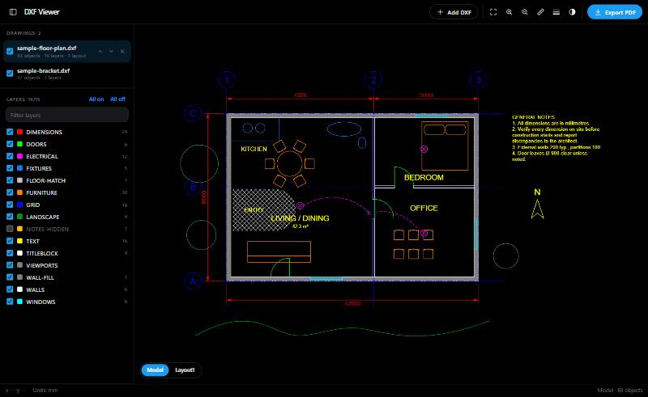

# DXF Viewer

A free, open-source DXF viewer that runs entirely in your browser. Open several drawings at once, pan and zoom, toggle layers, inspect objects, measure distances, and print everything into **one combined PDF**.

It's a single HTML file with no dependencies, no build step, and no server. Your drawings never leave your computer.

## Use it

1. Download [`index.html`](index.html), or clone the repo.
2. Double-click it to open it in Chrome, Edge, Firefox or Safari.
3. Click **Add DXF** (or drop files onto the window). Pick as many as you like.

To see what it does without your own files, click **Try two samples**.

## Features

**Viewing**
- Smooth zoom (mouse wheel zooms where the cursor is), drag to pan, pinch on touch screens, **F** to fit
- Model space and paper-space **layouts as tabs**, with the drawing shown through each sheet's viewport (including per-viewport frozen layers)
- Dark (CAD-style) or light canvas
- Optional lineweight display

**Layers**
- Per-drawing layer list with color swatches and object counts
- Toggle, **Only** (isolate), zoom to layer, filter by name, all on / all off
- Respects layers that are off or frozen in the file
- Hiding the layer of a block reference hides the whole block

**Inspect and measure**
- Click any object to see its type, layer, block, color, linetype, lineweight and length, and to hide or isolate its layer
- **Measure** (M): distance, ΔX, ΔY and angle, with vertex snapping. Feet-and-inches for imperial drawings.
- Live cursor coordinates and drawing units

**Combined PDF export**
- Every ticked drawing goes into one vector PDF, in the order you choose, with a bookmark per page
- **Paper:** Letter, Legal, Tabloid, ARCH C/D/E, A4–A0
- **Orientation:** auto, portrait or landscape
- **Scale:** fit to page, metric (1:1 … 1:1000) or architectural/engineering (1/4" = 1'-0", 1" = 20', …)
- **Area:** whole drawing or what's on screen
- **Pages:** current tab, or model plus every layout
- **Color:** black & white, grayscale or color
- **Also:** lineweights from the drawing (or fine/bold), margins, and a file-name/page-number footer
- Hidden layers stay hidden. Text stays selectable and searchable.

## Supported DXF content

LINE, LWPOLYLINE and POLYLINE (bulges, 3D, polyface and polygon meshes), CIRCLE, ARC, ELLIPSE, SPLINE (NURBS and fit points), TEXT, MTEXT (formatting codes, word wrap, stacked fractions), ATTRIB, INSERT (nested blocks, arrays, mirrored/OCS extrusion), DIMENSION, HATCH (solid fills and pattern lines, including arc/ellipse/spline boundary edges), SOLID, TRACE, 3DFACE, LEADER, ACAD_TABLE, IMAGE frames, and VIEWPORT.

Also handled: ByLayer/ByBlock colors, true color, linetypes and linetype scale, lineweights, `%%c` / `%%d` / `%%p` symbols, `\U+` escapes, and UTF-8 or ANSI (Windows-1252) files.

## Limitations

- **DWG and binary DXF** aren't supported. Save as ASCII DXF from your CAD program.
- **Not drawn:** MULTILEADER, raster image contents, wipeouts, and 3D solids/regions (ACIS). The status bar lists anything it skipped.
- **Fonts:** text uses Arial/Helvetica instead of SHX fonts, so widths can differ slightly from AutoCAD.
- **Viewports:** only plan views are drawn; 3D view directions are ignored.

## Keyboard shortcuts

| Key | Action |
| --- | --- |
| F | Zoom to fit |
| + / − | Zoom in / out |
| M | Measure tool |
| B | Toggle dark / light canvas |
| W | Toggle lineweights |
| Esc | Clear selection or measurement |

## How it works

Everything is in [`index.html`](index.html):

- **Parser:** a small DXF parser reads the header, tables (layers, linetypes, block records), blocks, entities and layout objects.
- **Flattening:** entities are flattened (blocks expanded, arcs and splines tessellated) into batches grouped by layer, color, linetype and lineweight.
- **Canvas:** batches are drawn with cached `Path2D` objects, so redraws stay fast on large files.
- **PDF writer:** a built-in writer emits vector paths and Helvetica text, compressed with the browser's native `CompressionStream`. It uses no PDF library.

## Contributing

Issues and pull requests are welcome. A DXF that renders incorrectly makes the most useful bug report. Please attach the file, or a trimmed copy that still shows the problem.

## License

[MIT](LICENSE)
